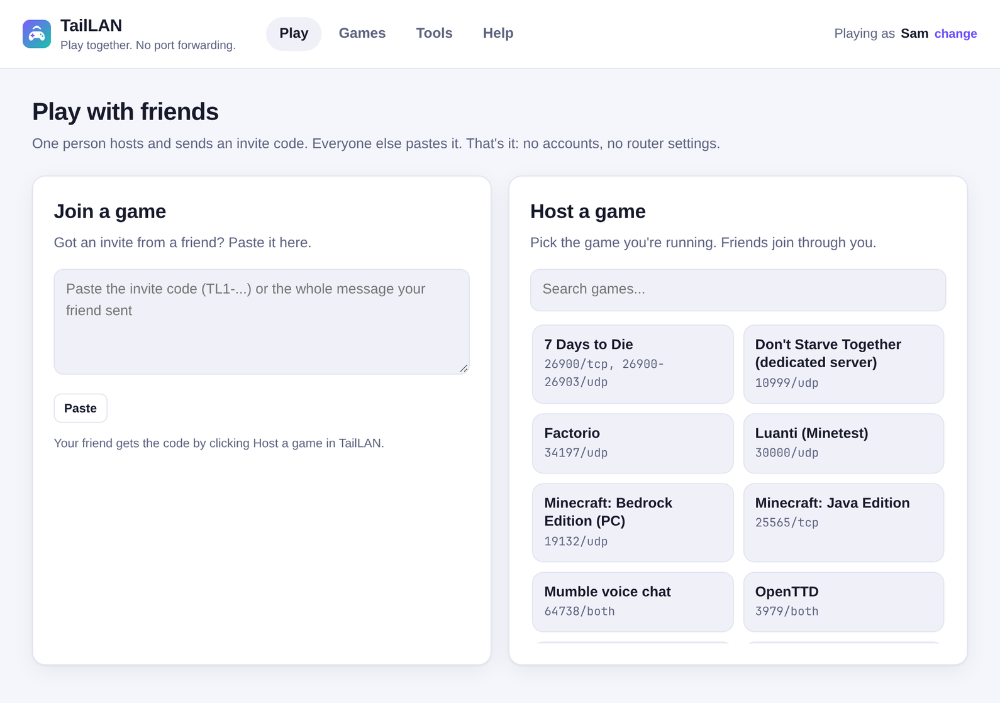
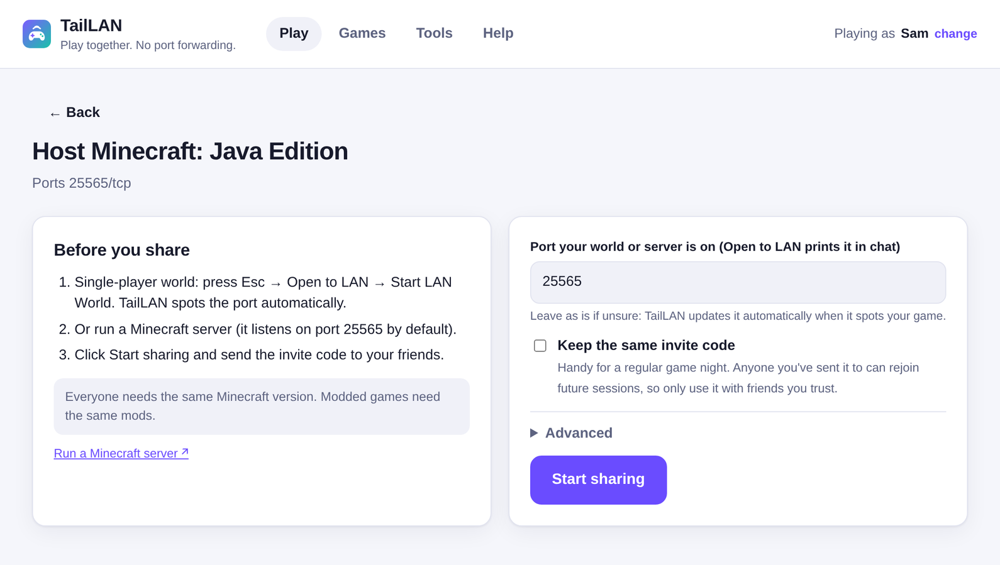
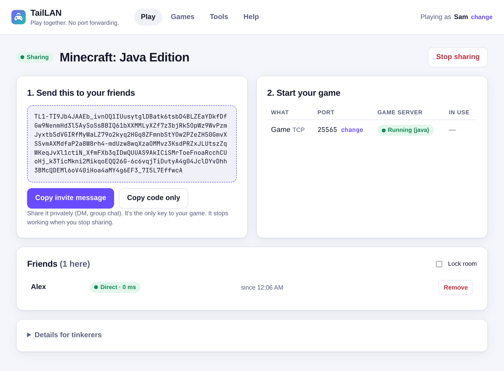
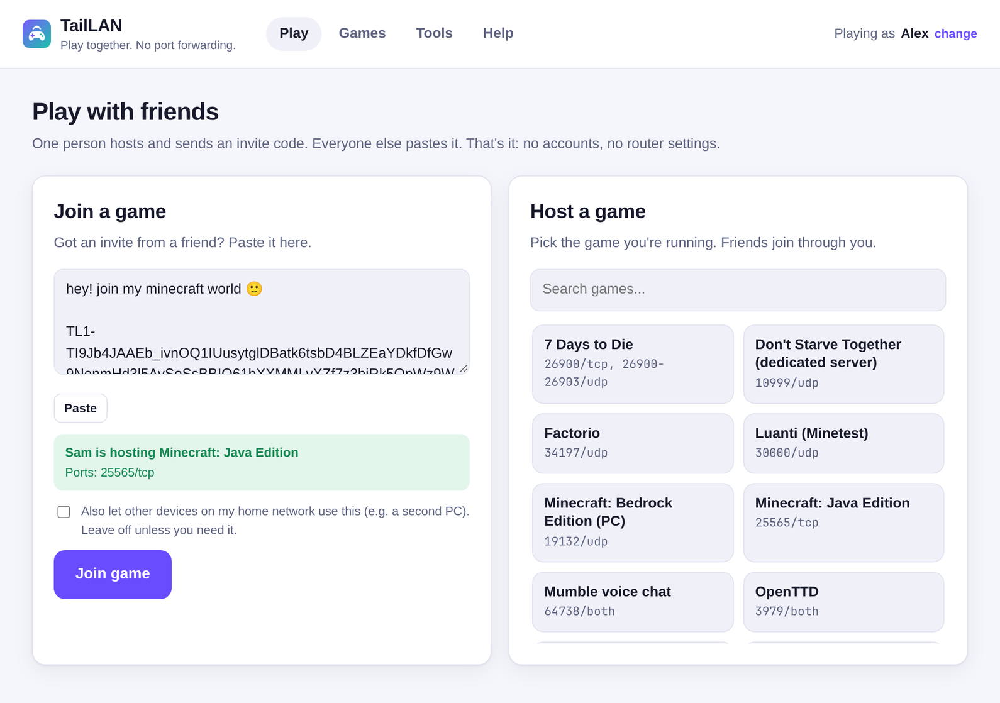
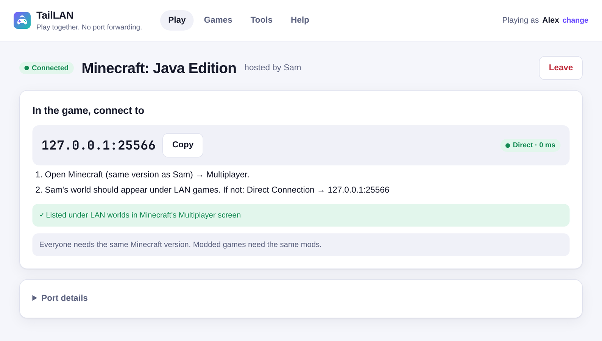

# TailLAN

**Play multiplayer games with friends over the internet, as if you were on the same LAN.** One person hosts and sends an invite code; friends paste it and play. No accounts, no port forwarding, no router settings, no admin rights.

TailLAN is a single small app for Windows, macOS and Linux, built on [tailcat](https://github.com/tailscale/tailcat), Tailscale's open-source "netcat over WireGuard". Game traffic goes through an end-to-end encrypted tunnel straight to the host's computer.

## Host a game

<table>
  <tr>
    <th width="50%">1. Pick your game</th>
    <th width="50%">2. Start your game, then click <b>Start sharing</b></th>
  </tr>
  <tr>
    <td></td>
    <td></td>
  </tr>
  <tr>
    <th colspan="2">3. Click <b>Copy invite message</b> and send it to your friends. They show up as they join.</th>
  </tr>
  <tr>
    <td colspan="2" align="center"></td>
  </tr>
</table>

Game not in the list? Pick **Another game** and type its ports, or [add it](docs/adding-a-game.md) for everyone.

## Join a game

<table>
  <tr>
    <th width="50%">1. Paste the invite and click <b>Join game</b></th>
    <th width="50%">2. In the game, connect to the address shown</th>
  </tr>
  <tr>
    <td></td>
    <td></td>
  </tr>
</table>

Friends don't need to set anything up: the invite carries the game, its ports and the steps. It stops working when the host stops sharing.

## Download

Get the file for your system from the [latest release](https://github.com/LaneBirmingham/taillan/releases/latest) and run it. There's nothing to install.

| System | File | First run |
|--------|------|-----------|
| Windows | `taillan-windows-amd64.exe` | Double-click it. If Windows Firewall asks, allow private networks. |
| macOS (Apple silicon) | `taillan-darwin-arm64` | `chmod +x taillan-darwin-arm64 && xattr -d com.apple.quarantine taillan-darwin-arm64 && ./taillan-darwin-arm64` |
| macOS (Intel) | `taillan-darwin-amd64` | Same as above, with `amd64`. |
| Linux | `taillan-linux-amd64` | `chmod +x taillan-linux-amd64 && ./taillan-linux-amd64` |

ARM builds for Windows and Linux are there too.

## More

- [More about TailLAN](docs/README.md): features, the built-in games, finding a game's ports, the command line, security, limitations and how it works.
- [Add a game](docs/adding-a-game.md) (one JSON file, no code) or [write a game helper](docs/helpers.md).
- [Contributing](CONTRIBUTING.md) · [Security policy](SECURITY.md)

## License

[MIT](LICENSE). TailLAN is built on tailcat, Tailscale and other open source components under BSD 3-Clause and similar licenses. Their notices are in [THIRD_PARTY_NOTICES.txt](THIRD_PARTY_NOTICES.txt) and inside every binary (`taillan licenses`).

TailLAN is an independent project, not affiliated with or endorsed by Tailscale Inc. or any game publisher. Game names are trademarks of their owners.
