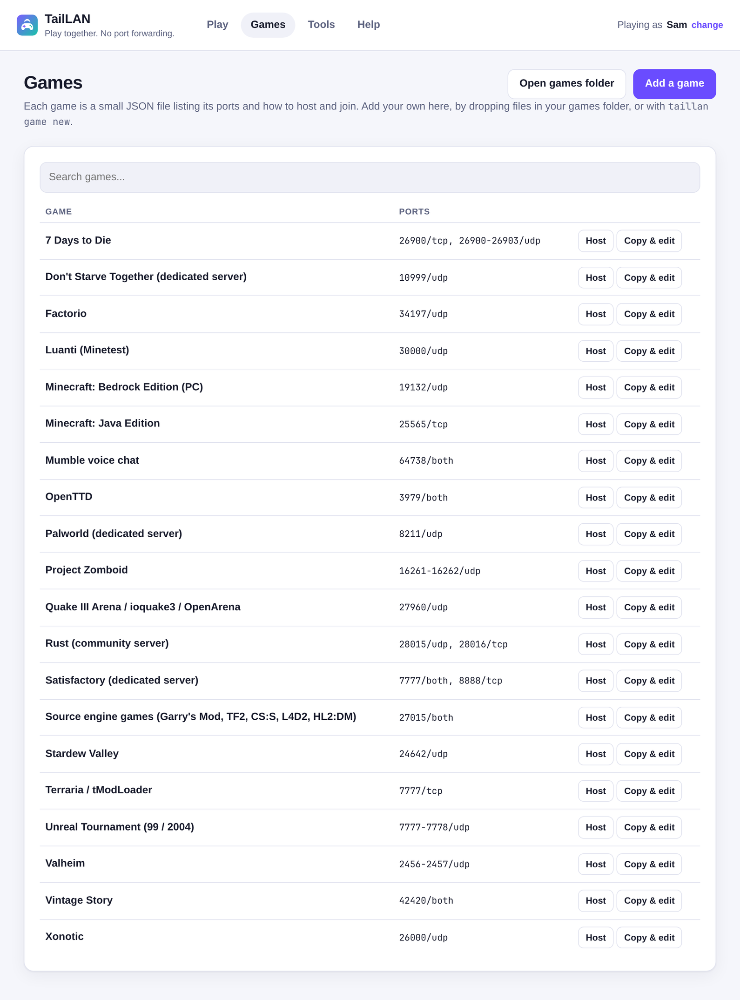
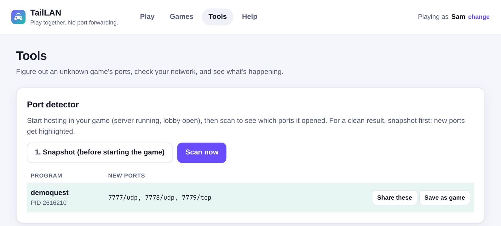

# More about TailLAN

The [main README](../README.md) shows how to host and join. This page covers everything else.

- [Features](#features)
- [Built-in games](#built-in-games)
- [Any other game](#any-other-game)
- [Running TailLAN](#running-taillan)
- [Command line](#command-line)
- [Security](#security)
- [Limitations](#limitations)
- [How it works](#how-it-works)
- [Development](#development)

```
  Host's PC                                          Friend's PC
 ┌──────────────────────┐                          ┌──────────────────────┐
 │ game server :25565   │                          │ game client          │
 │        ▲             │   encrypted tailcat      │   connects to        │
 │        │             │   tunnel (P2P, or relay  │   127.0.0.1:25565    │
 │ TailLAN (host) ◀─────┼──────── if needed) ──────┼──▶ TailLAN (join)    │
 └──────────────────────┘                          └──────────────────────┘
```

## Features

- **One file for Windows, macOS and Linux.** A single static binary. The UI opens as an app window (Edge, Chrome, Chromium or Brave in app mode, or your default browser).
- **TCP and UDP.** Most games use UDP. tailcat's own CLI forwards only TCP, so TailLAN forwards UDP flows on top of the tailcat library.
- **Invite codes carry everything.** The game, its ports and the steps travel inside the code, so friends don't need the game set up in TailLAN.
- **20 games built in** (below), plus **any game** by port number.
- **Host controls.** See who joined, whether each friend has a **Direct** or **Relayed** connection and their ping, **Lock room** once everyone's in, and **Remove** someone. **Keep the same invite code** gives a regular game night one code that works every time.
- **Game server check.** The host screen shows live whether the game is listening, and which program it is.
- **Smart local ports.** If a port is busy on a friend's machine, TailLAN shifts it (keeping ranges together) and updates the instructions.
- **Game helpers** for the last bit of friction. For Minecraft, TailLAN finds your *Open to LAN* port by itself and lists the world in friends' **LAN worlds**.
- **Port detector** and **network check** under *Tools* (see [Any other game](#any-other-game)).
- **Terminal mode** for everything: `taillan host`, `taillan join`, `taillan detect`, `taillan doctor`...

## Built-in games

| Game | Ports |
|------|-------|
| 7 Days to Die | 26900/tcp, 26900-26903/udp |
| Don't Starve Together (dedicated server) | 10999/udp |
| Factorio | 34197/udp |
| Luanti (Minetest) | 30000/udp |
| Minecraft: Bedrock Edition (PC) | 19132/udp |
| Minecraft: Java Edition (+ LAN helper) | 25565/tcp |
| Mumble voice chat | 64738/both |
| OpenTTD | 3979/both |
| Palworld (dedicated server) | 8211/udp |
| Project Zomboid | 16261-16262/udp |
| Quake III Arena / ioquake3 / OpenArena | 27960/udp |
| Rust (community server) | 28015/udp, 28016/tcp |
| Satisfactory (dedicated server) | 7777/both, 8888/tcp |
| Source engine games (Garry's Mod, TF2, CS:S, L4D2, HL2:DM) | 27015/both |
| Stardew Valley | 24642/udp |
| Terraria / tModLoader | 7777/tcp |
| Unreal Tournament (99 / 2004) | 7777-7778/udp |
| Valheim | 2456-2457/udp |
| Vintage Story | 42420/both |
| Xonotic | 26000/udp |

The **Games** tab lists them all, with your own games alongside.

<p align="center"></p>

## Any other game

Any game that lets players connect by IP address works. On the Play screen pick **Another game** and type its ports. Don't know them? Start the game's server or lobby, then use the **Port detector** under *Tools*: it shows which ports the game opened, ready to share or save as a game.

<p align="center"></p>

To add a game for everyone (one JSON file, no code), see [Adding a game](adding-a-game.md). Games that need a bit of code, for example to show up in a LAN server list, use a [helper](helpers.md).

*Tools* also has a **network check** (`taillan doctor` in a terminal): relay reachability, UDP, NAT type and a full end-to-end tunnel self-test.

## Running TailLAN

- **Windows**: a console window shows activity; closing it quits TailLAN. Windows Firewall may ask to allow TailLAN: allow it on private networks for the fastest direct connections (it still works through relays if you don't).
- **macOS**: the binary isn't notarized, so run `xattr -d com.apple.quarantine <file>` once (or right-click → Open).
- **Linux**: `chmod +x <file>` and run it.

Closing the window keeps a shared game running. Run TailLAN again to bring the window back (only one copy runs at a time). With nothing shared and no window open, it exits on its own after two minutes.

Your settings and games live in your config folder (`taillan game dir` prints the games folder). Set `TAILLAN_HOME` to use a different one.

### Build from source

Needs Go (version in [`mise.toml`](../mise.toml)):

```sh
make build          # ./taillan for this machine
make release        # dist/ for Windows, macOS, Linux (amd64 + arm64)
```

## Command line

```
taillan                      open the app
taillan host <game|ports>    share from the terminal: taillan host valheim
                             or by ports:            taillan host "7777/udp, 27015/tcp" --name "My Game"
                             flags: --extra <ports>, --target <ip>, --port <n>, --keep
taillan join <invite>        join from the terminal (or just: taillan TL1-...)
taillan games [search]       list games
taillan game new             add a game (asks a few questions; --from-process <name> reads ports from a running server)
taillan game validate <f>    check game files
taillan game show <id>       print a game's JSON
taillan game dir             your games folder
taillan detect [--watch]     which ports are programs listening on? --watch shows only new ones
taillan doctor               network check
taillan helpers              list game helpers
taillan licenses             licenses of TailLAN and its components
```

## Security

- All game traffic is end-to-end encrypted by WireGuard (tailcat uses a fresh key per session and a pre-shared key inside the invite). Relays only see encrypted packets.
- **The invite code is the key.** Anyone with it can connect while you share, so send it privately. Use **Lock room** once everyone's in. **Remove** kicks someone and locks the room, since anyone with the code could otherwise come back under a new identity.
- Only the game's ports are reachable through the tunnel, and only to the address you chose (the host's own machine by default). Nothing else on your computer or network is exposed.
- On joiners' machines, forwarded ports listen on `127.0.0.1` only. Ports a game marks `lan` (for LAN discovery) listen on all interfaces but accept connections only from the same computer, unless the joiner explicitly allows their LAN.
- The UI is served on `127.0.0.1` and protected by a per-run secret, Host/Origin checks (against DNS rebinding and cross-site requests) and a strict Content Security Policy.
- **Keep the same invite code** saves the host key in your config folder (`keys/`). Anyone you've ever sent that code to can rejoin future sessions until you click *Retire invite* in the Games tab.

Found a vulnerability? See the [security policy](../SECURITY.md).

## Limitations

TailLAN forwards a game's ports from friends to one host. It's not a full virtual LAN, so these don't work (or don't need it):

- Games that only use Steam, Epic or console matchmaking or invites (use the platform's invites).
- Games that find servers only by LAN broadcast and have no way to type an address (unless a helper exists, as for Minecraft).
- Peer-to-peer games where every player connects to every other player (some older RTS games).
- Consoles.
- UDP packets larger than 1232 bytes may be dropped by the tunnel; TailLAN warns if a game sends them.

tailcat's public relays are free but rate-limited and best-effort. Direct connections (the usual case) don't use them for game traffic.

## How it works

The host runs a `tailcat.Server` that only admits the game's ports and proxies each TCP connection or UDP flow to the game server. Its address (public key, pre-shared key, relay region) goes into the invite with the game's ports and steps: `TL1-` + base64url(DEFLATE(JSON)). Each friend runs a `tailcat.Client` and opens matching local listeners; every local TCP connection or UDP source gets its own stream or flow through the tunnel. A small JSON-lines control channel on a reserved tunnel port (65531) carries names, latency and a clean "host stopped" signal. Connections start through tailcat's DERP relays, and NAT traversal upgrades them to a direct path whenever possible.

Code map: [`internal/session`](../internal/session) (host/join engine), [`internal/profile`](../internal/profile) + [`games/`](../games) (game profiles), [`internal/invite`](../internal/invite), [`internal/helpers`](../internal/helpers), [`internal/portscan`](../internal/portscan), [`internal/doctor`](../internal/doctor), [`internal/ui`](../internal/ui) (local web UI), [`main.go`](../main.go) (CLI).

## Development

```sh
make test       # unit tests + a real host/join round trip over tailcat (needs internet; TAILLAN_SKIP_NET=1 to skip)
make run        # build and open the app
make notices    # refresh THIRD_PARTY_NOTICES.txt after changing go.mod
```

Run two copies on one machine (host and friend) by giving each its own config folder: `TAILLAN_HOME=/tmp/friend taillan`. The second one picks a free UI port, and joined games shift to free local ports automatically.

Game profiles are especially welcome: see [CONTRIBUTING.md](../CONTRIBUTING.md). Releases are built by GitHub Actions when a `v*` tag is pushed.
